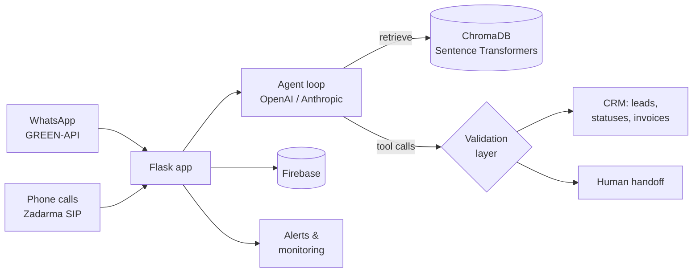

# AI Sales Agent - case study

> LLM agent that qualifies leads over WhatsApp and phone, works with the CRM through tool calling, and hands off to a human when it should.
> **Code is private** (commercial product); this repository documents the problem, architecture and engineering decisions.

**In production at four businesses:** coworking, automotive detailing, construction, chess education
**Role:** built and deployed the platform end to end
**Stack:** Python, Flask, OpenAI and Anthropic APIs, Sentence Transformers, ChromaDB, GREEN-API (WhatsApp), Zadarma SIP telephony, Firebase, Docker, VPS

---

## Problem

Small businesses lose leads because nobody answers fast enough, follow-ups are forgotten, and managers make the same mistakes on calls. Hiring more sales staff is expensive.

## What the agent does

- Answers incoming **WhatsApp** messages and handles **voice calls**, qualifies the lead and follows up automatically.
- **Creates and updates CRM leads and generates invoices** through tool calling.
- Answers questions about services, policies, customer rights and timelines from a **RAG knowledge base** instead of from model memory.
- **Hands off to a human consultant** when the request is out of scope or a decision needs a person.
- **Analyses recorded sales calls** and produces an individual quality report per manager: missed steps, typical mistakes, what to fix.

## Architecture

## Engineering decisions

- **The model proposes, the application decides.** Every AI-initiated action (create lead, change status, issue invoice) goes through application-level validation before it touches the CRM.
- **Two-layer instructions.** Security rules are controlled by the application and cannot be edited by the business; sales instructions (offers, prices, tone) live in a separate business-editable layer. Sales managers update their content without code changes and without being able to weaken the guardrails.
- **RAG for facts.** Service policies, customer rights and timelines are retrieved from a vector store, so answers follow the company's real rules and can be updated without retraining or re-prompting.
- **Multi-provider.** Both OpenAI and Anthropic models are integrated, so the provider can be chosen per task by quality and cost.
- **Production basics.** Deployed on a VPS with automatic container recovery, system-load notifications and critical alerts.

## Contact

Happy to walk through the system in an interview - GitHub: [@salomat423](https://github.com/salomat423)
